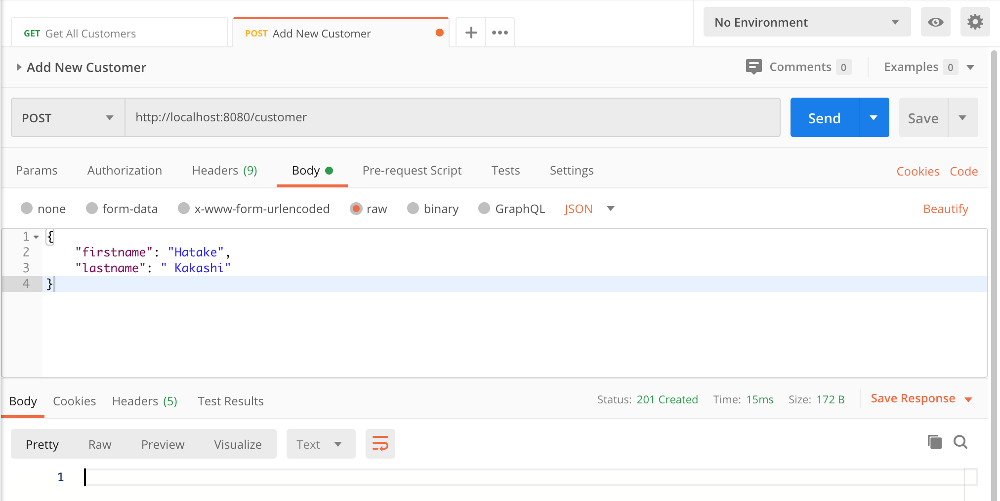
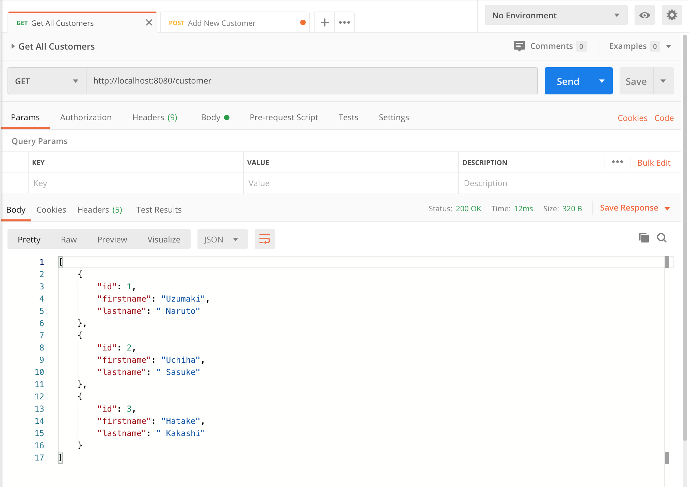
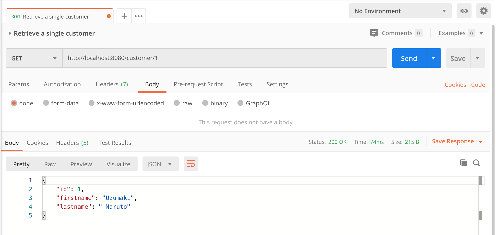
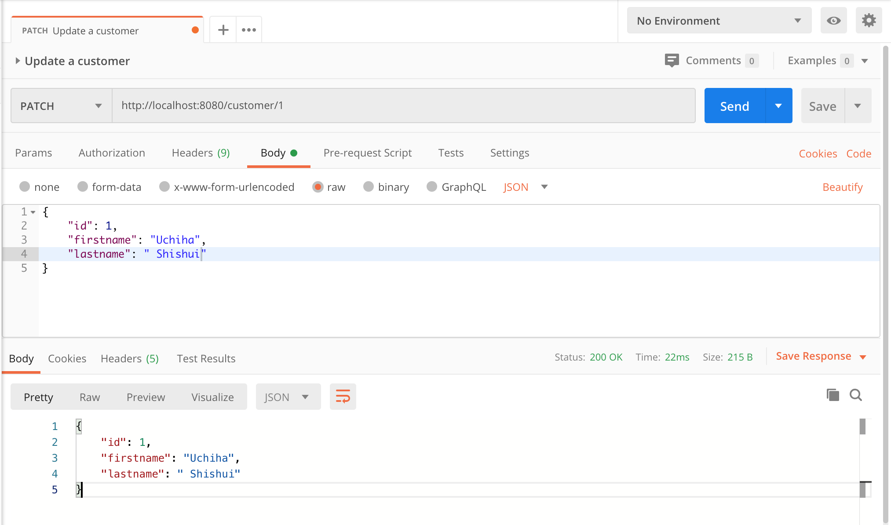
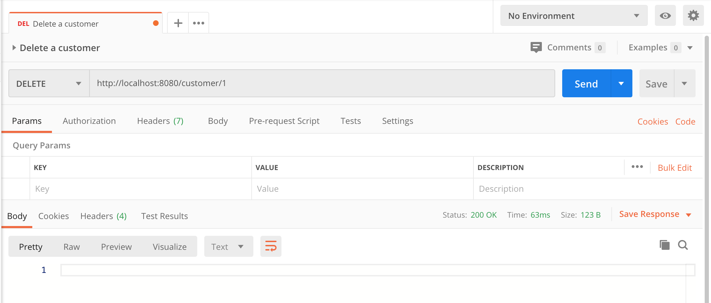

# Spring Boot RESTful Web Service Example

[](https://github.com/hendisantika/spring-boot-rest/actions/workflows/maven.yml)
[](https://github.com/hendisantika/spring-boot-rest/actions/workflows/master_test5.yml)


A sample web service application built with Spring Boot. It exposes a `Customer` entity with full CRUD operations
over REST, backed by an in-memory H2 database via Spring Data JPA.

## Tech Stack

- Java 25
- Spring Boot 4.1.0 (Web, Data JPA)
- H2 in-memory database
- Maven (wrapper included)

## Prerequisites

- JDK 25 (e.g. [Eclipse Temurin](https://adoptium.net/) or Microsoft Build of OpenJDK)
- No local Maven install needed — use the bundled `./mvnw`

## Getting Started

1. Clone this repository: `git clone https://github.com/hendisantika/spring-boot-rest.git`
2. Go to the folder: `cd spring-boot-rest`
3. Run the application: `./mvnw clean spring-boot:run`
4. The API is available at `http://localhost:8080`

Build and run the tests / executable JAR:

```bash
./mvnw clean package
java -jar target/spring-boot-rest-0.0.1.jar
```

## API Endpoints

| Method   | Endpoint         | Description                     | Success response              |
|----------|------------------|---------------------------------|-------------------------------|
| `GET`    | `/customer`      | List all customers              | `200 OK` (or `204 No Content`) |
| `GET`    | `/customer/{id}` | Get a customer by id            | `200 OK`                      |
| `POST`   | `/customer`      | Create a customer               | `201 Created` + `Location`    |
| `PUT`    | `/customer/{id}` | Replace a customer              | `200 OK`                      |
| `PATCH`  | `/customer/{id}` | Partially update a customer     | `200 OK`                      |
| `DELETE` | `/customer/{id}` | Delete a customer               | `200 OK`                      |

Unknown ids return `404 Not Found`; creating a customer that already exists returns `409 Conflict`.

Example:

```bash
curl -i -X POST http://localhost:8080/customer \
  -H 'Content-Type: application/json' \
  -d '{"firstname":"Hendi","lastname":"Santika"}'

curl http://localhost:8080/customer
```

### Postman

1. Open the [Postman](https://www.postman.com/downloads/) app.
2. Import `Spring Boot Rest Example.postman_collection.json` from this repository.

## CI/CD

- **Java CI with Maven** (`.github/workflows/maven.yml`) — builds and tests on JDK 25 for every push and pull request
  to `master`, then submits the dependency graph to GitHub.
- **Build and deploy JAR app to Azure Web App** (`.github/workflows/master_test5.yml`) — builds the JAR on every push to
  `master`. The deploy job is opt-in: set the repository variable `AZURE_DEPLOY_ENABLED` to `true` once the Azure
  credentials (`AZUREAPPSERVICE_*` secrets) have access to a subscription.
- **Dependabot** (`.github/dependabot.yml`) — daily Maven updates (Spring and other minor/patch bumps grouped) and a
  weekly grouped GitHub Actions update, labelled and using Conventional Commit prefixes.

## Screenshots

Add New Customer



List All Customers



Filter Customer by Id



Patch Customer Data



Delete Customer Data


